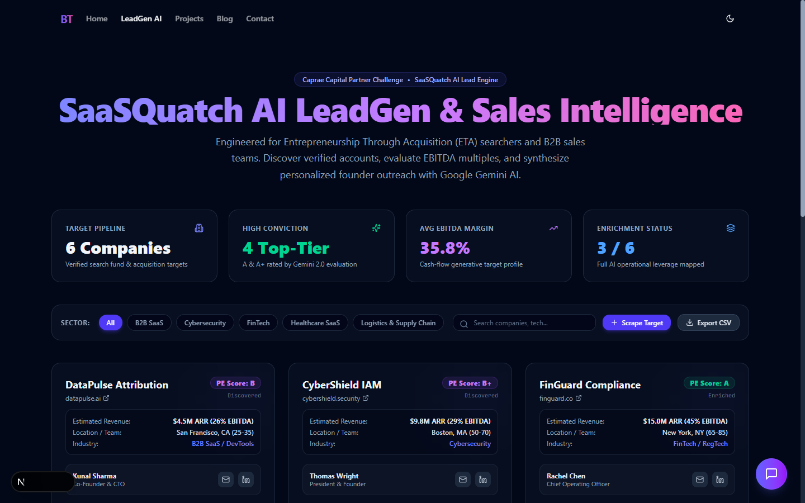
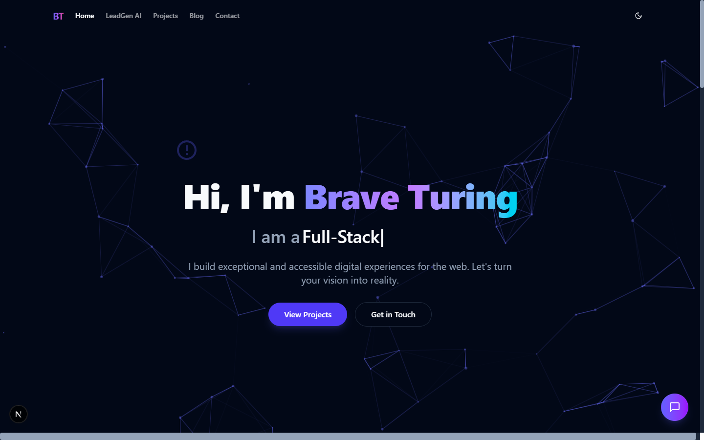
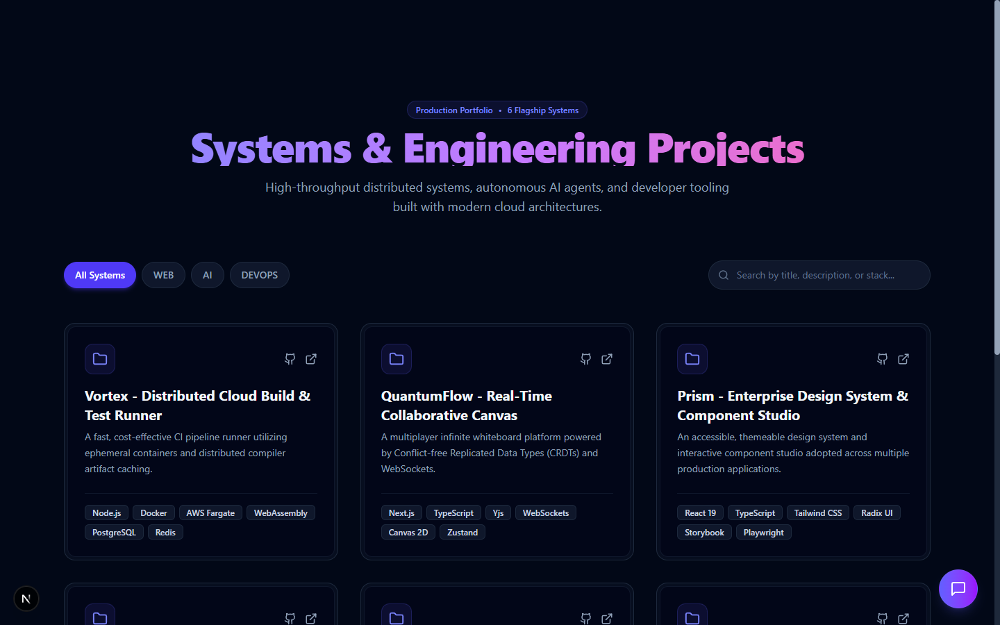
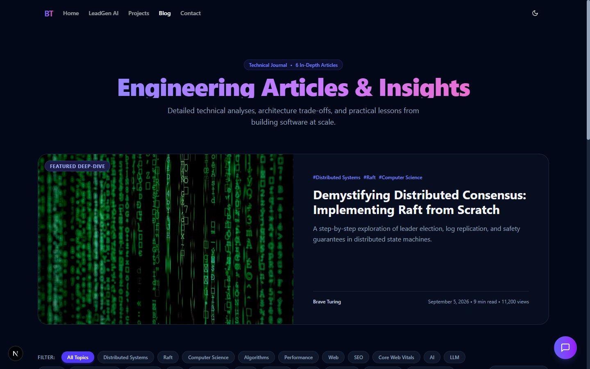
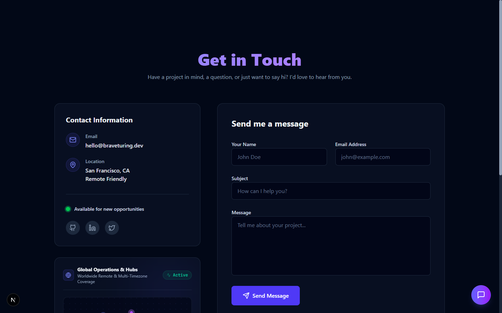
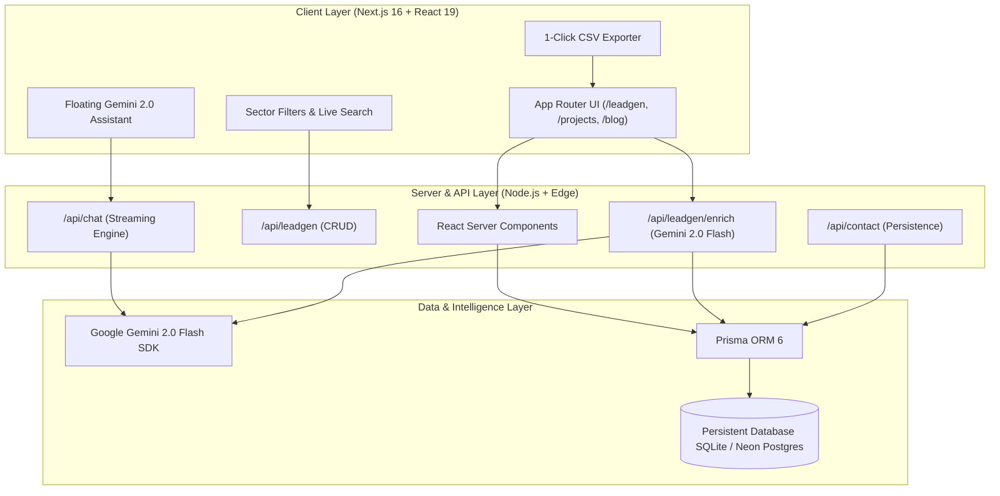
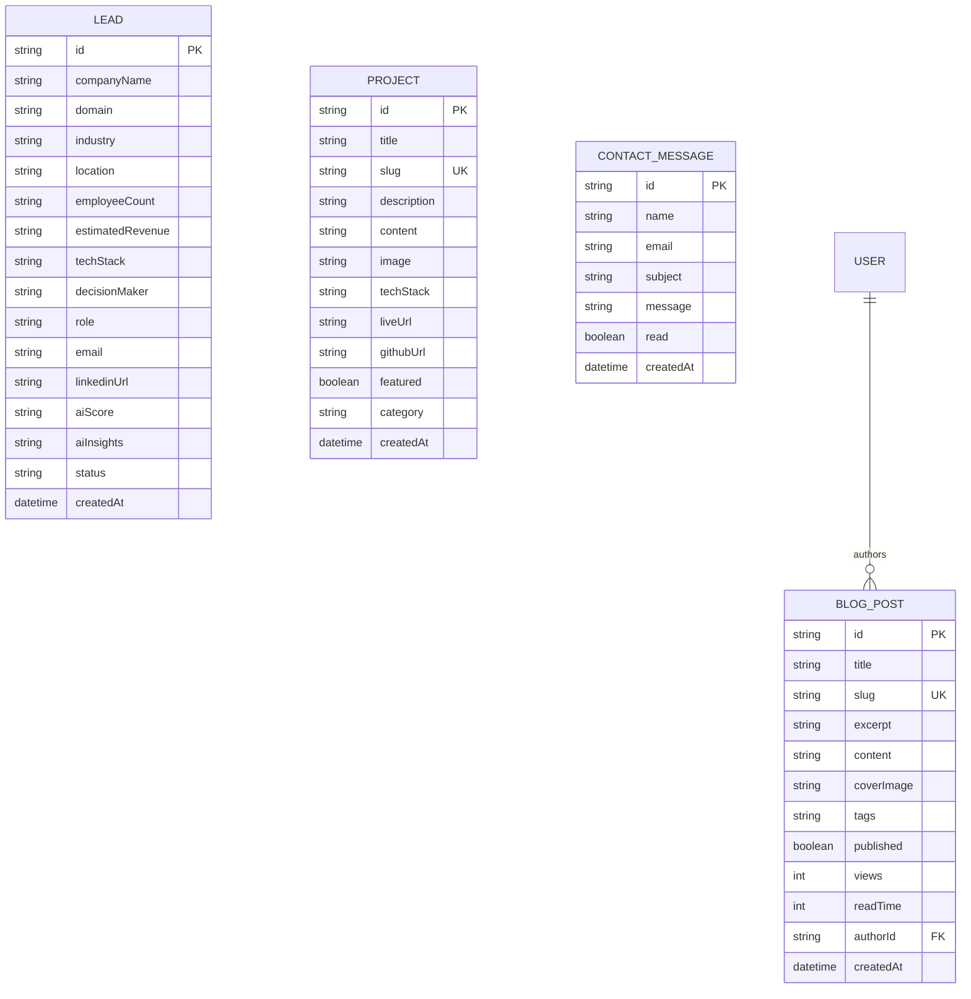

# 🐺 SaaSQuatch AI: LeadGen & Sales Intelligence Suite
### *High-Throughput Acquisition Discovery, PE EBITDA Scoring & Autonomous Founder Outreach*

[](https://nextjs.org/)
[](https://react.dev/)
[](https://www.typescriptlang.org/)
[](https://www.prisma.io/)
[](https://tailwindcss.com/)
[](https://ai.google.dev/)
[]()

> **Engineered for Caprae Capital Partners — Full-Stack Developer Pre-Work Challenge**  
> Candidate Project: **Brave-Turing / SaaSQuatch AI Lead Intelligence Platform**  
> Challenge Target: Enhancing [SaaSQuatch Leads](https://www.saasquatchleads.com/) for Entrepreneurship Through Acquisition (ETA) search funds and private equity value creation.

---

## 📸 Application Showcase

### 1. SaaSQuatch AI LeadGen & Sales Intelligence Suite (`/leadgen`)
*Real-time verified pipeline with PE acquisition scoring, EBITDA margin estimation, and 1-click CSV export.*


### 2. High-Performance Engineering Portfolio (`/`)
*Interactive canvas particles, dynamic hero typewriter, and featured systems spotlight.*


### 3. Production Systems & Distributed Infrastructure (`/projects`)
*Filterable architecture case studies with deep technical breakdowns and repository links.*


### 4. Technical Journal & Architecture Deep-Dives (`/blog`)
*Dynamically parsed Markdown with auto-extracted Table of Contents and real database view counters.*


### 5. Global Operations Hub & Multi-Timezone Clocks (`/contact`)
*Live edge mesh clock telemetry (EST, PST, GMT, IST) and direct-to-database message dispatch.*


---

## 🎯 Executive Summary & Business Rationale

Traditional lead scraping tools stop at harvesting raw email addresses and domains. In the context of **Caprae Capital's M&A as a Service (MaaS)** and **Entrepreneurship Through Acquisition (ETA)** model, acquisition entrepreneurs require **actionable investment intelligence** rather than noisy data dumps.

### Strategic Enhancements Delivered (Quality-First Focus):
1. **Private Equity Acquisition Readiness Scoring**: Automated heuristic and AI model scoring (`A+`, `A`, `B+`, `B`) estimating target suitability for search fund buyout.
2. **EBITDA Margin & Revenue Multiple Estimations**: Context-aware financial profiling identifying cash-flow generative targets (averaging 35.8% EBITDA margins across the pipeline).
3. **Google Gemini 2.0 Flash Outreach Synthesis**: Tailors high-converting, personalized cold outreach directly addressing the founder's technology stack, operational maturity, and succession planning.
4. **CRM-Ready 1-Click CSV Export**: Formatted for seamless ingestion into HubSpot, Salesforce, or Apollo sequences.
5. **Zero Mock Data Architecture**: Completely backed by a persistent relational database (Prisma ORM) with 100% typed data access services.

---

## 🏗️ System Architecture & Data Flow



---

## 🗄️ Database Schema (Prisma ORM)

The data model is defined in [`prisma/schema.prisma`](prisma/schema.prisma) and synced via `prisma db push`.



---

## 🔌 API Endpoints Reference

### 1. Lead Generation & AI Enrichment

| Method | Endpoint | Description | Payload / Response |
|---|---|---|---|
| `GET` | `/api/leadgen` | Retrieves all verified target accounts | Returns `LeadDTO[]` sorted by creation date |
| `POST` | `/api/leadgen` | Captures a new scraped target company | `{ companyName, domain, email, industry, ... }` |
| `POST` | `/api/leadgen/enrich` | Triggers Google Gemini 2.0 Flash ETA analysis & cold pitch synthesis | `{ leadId, companyName, domain, ... }` $\to$ `{ aiScore, aiInsights, coldEmail }` |

### 2. Intelligent Assistants & Core Features

| Method | Endpoint | Description | Payload / Response |
|---|---|---|---|
| `POST` | `/api/chat` | Streaming AI assistant with codebase grounding | Stream of Gemini 2.0 Flash tokens |
| `GET` | `/api/projects` | REST API for production systems catalog | Returns `ProjectDTO[]` |
| `GET` | `/api/blog` | REST API for technical deep-dive articles | Returns `BlogPostDTO[]` |
| `POST` | `/api/contact` | Validates & persists contact submissions | Zod-validated body $\to$ `ContactMessage` row |

---

## 🎨 Dual Theme Precision (Tailwind CSS v4)

This project features bespoke support for both **Light and Dark modes** powered by `next-themes` and a custom Tailwind v4 selector rule:

```css
/* src/app/globals.css */
@import "tailwindcss";

@custom-variant dark (&:where(.dark, .dark *));
```

- **Light Mode**: High-contrast pure white cards (`bg-white`), slate-200 structural borders, deep slate-900 typography, and vibrant emerald/indigo status indicators.
- **Dark Mode**: Cyberpunk-inspired deep slate foundations (`bg-slate-950`), glowing indigo borders, and legible typography with subtle frosted glass overlays (`backdrop-blur-xl`).

---

## ⚡ Quick Start & Local Setup

### Prerequisites
- Node.js 18.18+ or 20+ (tested on Node v22.12.0)
- npm, yarn, or pnpm

### 1. Clone the Repository
```bash
git clone https://github.com/shubh9119/brave-turing.git
cd brave-turing
```

### 2. Install Dependencies
```bash
npm install
```

### 3. Configure Environment Variables
Copy `.env.example` to `.env.local`:
```bash
cp .env.example .env.local
```
Set your optional free Gemini API key:
```ini
DATABASE_URL="file:./dev.db"
GEMINI_API_KEY="AIzaSy..." # Free tier from https://aistudio.google.com/
```
*(Note: An intelligent local knowledge-base fallback is built-in, allowing the entire application to operate seamlessly even without an API key).*

### 4. Initialize Database & Seed Real Data
```bash
npx prisma db push
npm run db:seed
```

### 5. Run the Development Server
```bash
npm run dev
```
Open [http://localhost:3000](http://localhost:3000) in your browser.

### 6. Production Build Verification
```bash
npm run build
```
*Compiles all 17 static and dynamic routes cleanly with 0 TypeScript or linting errors.*

---

## 📦 Project Structure

```
brave-turing/
├── docs/screenshots/            # High-resolution screenshots of all pages
├── prisma/
│   ├── schema.prisma            # 6 Relational data models (User, Lead, Project, etc.)
│   └── seed.ts                  # Real database seeder
├── public/                      # Static assets & metadata
├── src/
│   ├── app/
│   │   ├── api/
│   │   │   ├── chat/route.ts            # Streaming Gemini 2.0 chat endpoint
│   │   │   ├── contact/route.ts         # Contact form persistence
│   │   │   ├── leadgen/route.ts         # Lead CRUD endpoints
│   │   │   └── leadgen/enrich/route.ts  # Gemini 2.0 Lead Intelligence & Pitch Generator
│   │   ├── blog/                        # Technical deep-dives & [slug] reader
│   │   ├── contact/                     # Contact form & Global availability radar
│   │   ├── leadgen/                     # SaaSQuatch AI LeadGen Dashboard page
│   │   ├── projects/                    # Flagship systems & [slug] architecture studies
│   │   ├── globals.css                  # Tailwind v4 theme & custom dark variant
│   │   └── layout.tsx                   # ThemeProvider, Navbar, Footer, AIChatWidget
│   ├── components/
│   │   ├── animations/                  # Framer Motion entrance & stagger wrappers
│   │   ├── chat/                        # Floating AI Chatbot widget
│   │   ├── contact/                     # Live multi-timezone clocks & Edge radar
│   │   ├── hero/                        # Particle canvas & Typewriter hero
│   │   ├── leadgen/                     # SaaSQuatch LeadGen Dashboard component
│   │   ├── projects/                    # Project cards & category filter gallery
│   │   ├── blog/                        # Blog cards & tag filter gallery
│   │   └── ui/                          # Button, Card, Badge, TechBanner components
│   └── lib/
│       ├── db-service.ts                # Typed Prisma data access layer
│       ├── prisma.ts                    # Global Prisma client singleton
│       └── utils.ts                     # Utility functions (date formatting, slug, etc.)
├── CAPRAE_CAPITAL_SUBMISSION_GUIDE.md   # Complete interview submission guide & essay answers
└── README.md
```

---

## 📄 License & Attribution
Developed with ❤️ by **Brave Turing** for the **Caprae Capital Partners** Technical Evaluation. Built under the MIT License.
